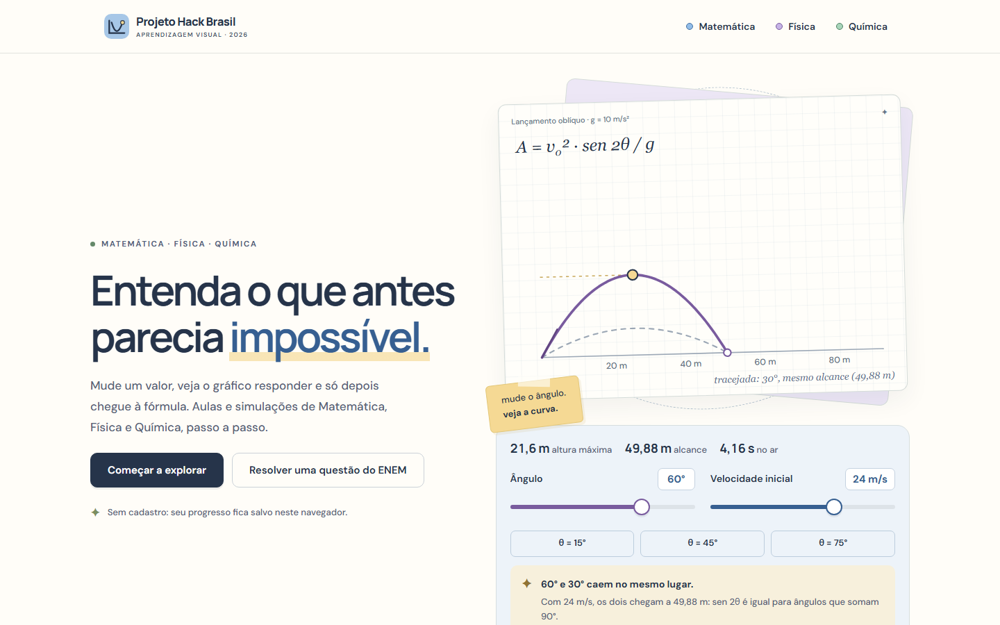
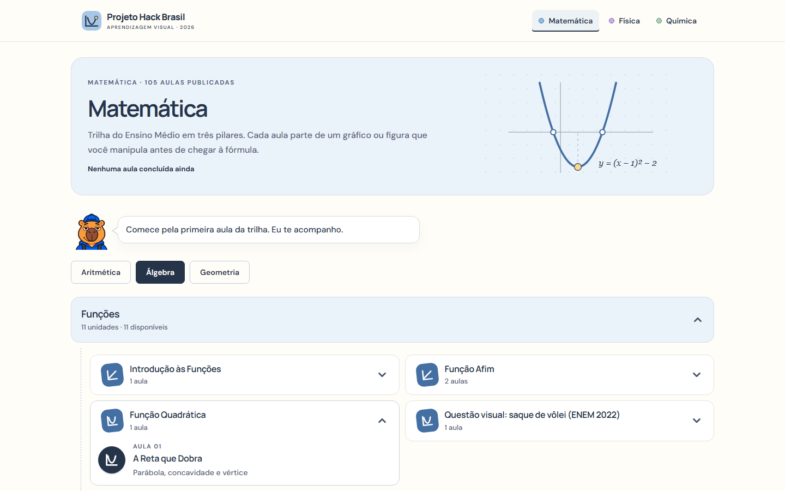
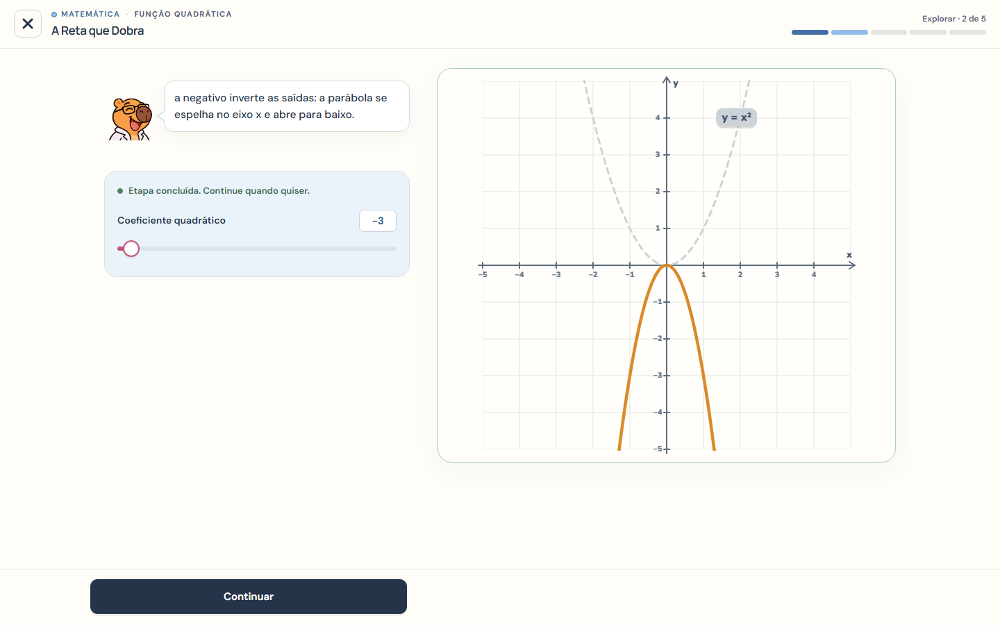
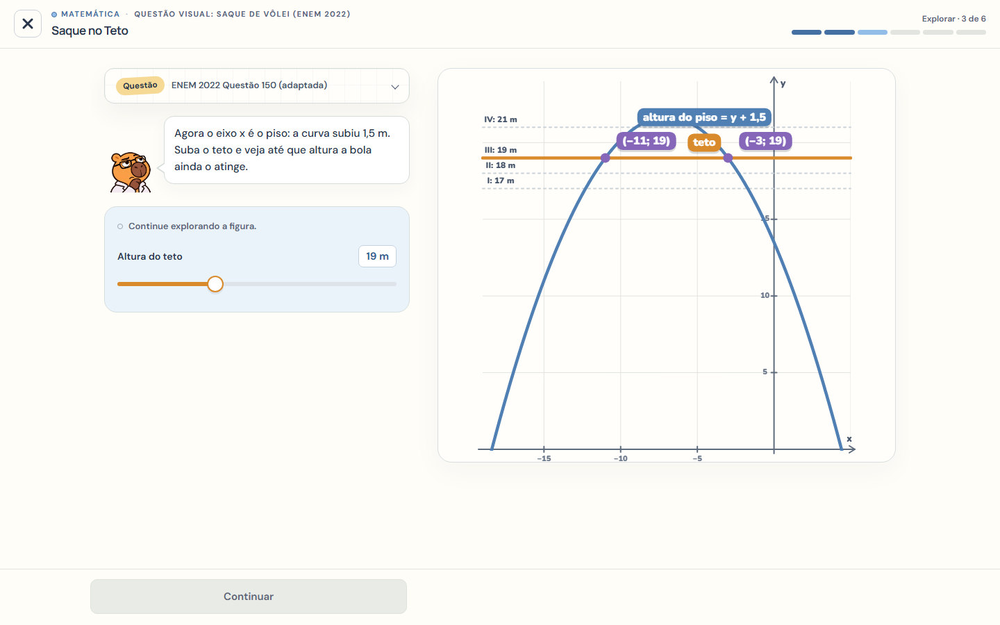
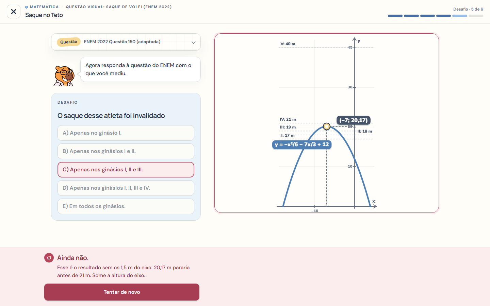
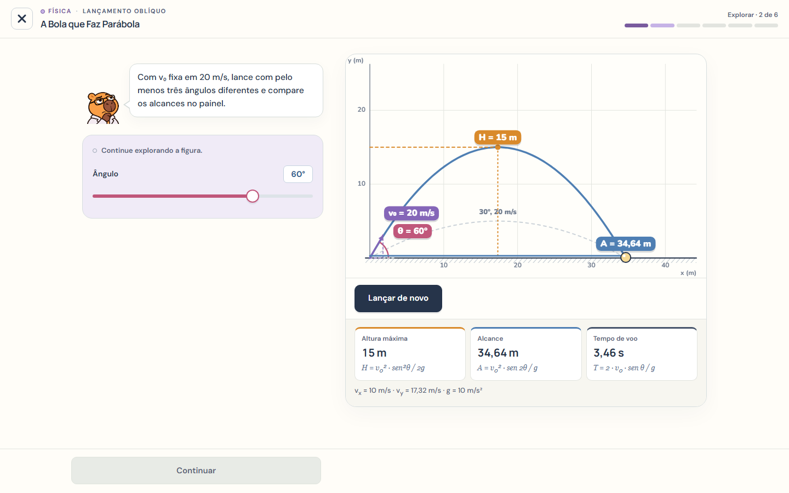
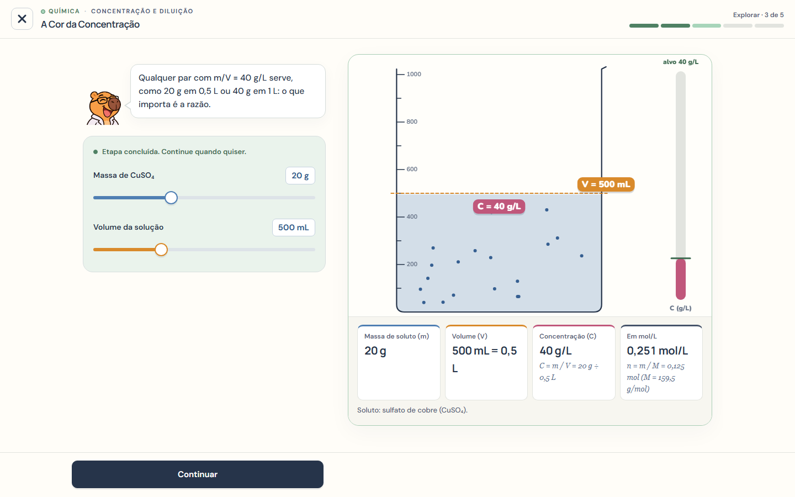
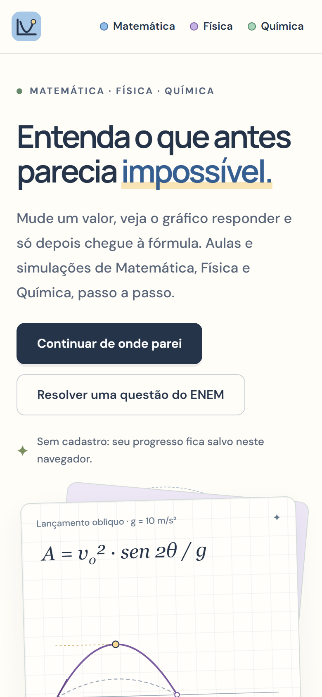
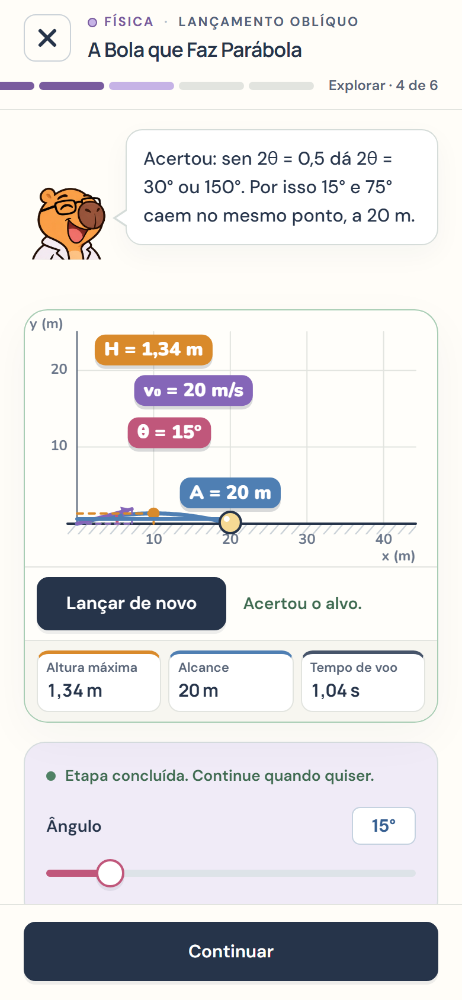
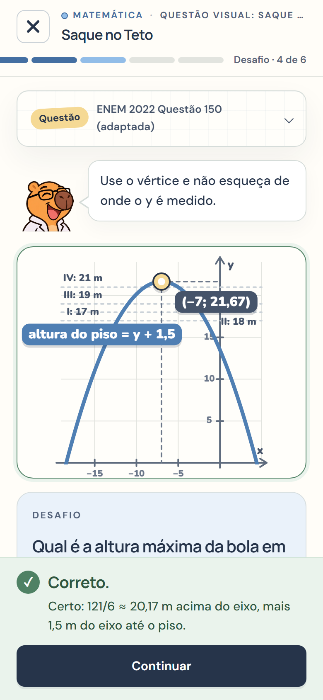

# Aula Visual

**Aprenda Matemática, Física e Química explorando gráficos, simulações e experiências interativas.**

Aula Visual é uma plataforma web gratuita para estudantes do Ensino Médio. Ninguém precisa decorar a fórmula antes de entender: o aluno mexe em um valor e vê o gráfico, a trajetória ou a solução responder. Só depois chega à regra. Funciona direto no navegador, sem cadastro e sem instalar nada.

Projeto participante do **Hack Brasil 2026**, trilha **Acesso à educação**.

<!-- Preencher só com endereços reais e testados (ver docs/ENTREGA_HACKBRASIL_2026.md):
**[Abrir a demo](URL-DA-DEMO)** · **[Assistir ao vídeo (até 3 min)](URL-DO-VIDEO)**
-->



---

## O problema

Grande parte do conteúdo de exatas do Ensino Médio chega ao aluno como fórmula pronta, num quadro ou numa página estática. Parábolas, trajetórias e concentrações são ideias dinâmicas: algo muda e outra coisa responde. Quando o estudante só vê o resultado final, sem poder variar nada, muitos memorizam regras sem entender de onde elas vêm e travam assim que a questão muda de formato.

Isso pesa mais para quem estuda sozinho, para quem não tem um professor disponível para tirar dúvidas e para quem se prepara para o ENEM com material que não permite experimentar.

## Nossa solução

Na Aula Visual, cada aula começa por uma **figura viva**. O aluno arrasta um ponto, move um controle ou dispara uma simulação e observa as consequências antes de ver a fórmula:

- **Variar e observar:** mudar o ângulo de um lançamento e ver o alcance mudar; subir o coeficiente de uma parábola e ver a curva virar; colocar mais soluto e ver a cor ficar mais forte.
- **Errar e entender o erro:** em cada desafio, a alternativa errada não recebe só um "incorreto". A figura muda para mostrar exatamente o engano daquela conta.
- **Chegar à fórmula pela causa:** no fechamento, cada letra da fórmula acende a parte correspondente do desenho.
- **Praticar:** cada aula termina com um treino em etapas (básico, desafios e, quando há fonte oficial conferida, questões reais de vestibular).

As aulas seguem um método didático de 7 pilares, documentado em [`docs/METODO.md`](docs/METODO.md).

## Funcionalidades implementadas

### Matemática: a base mais extensa



- **Trilha com 105 aulas interativas** do Ensino Médio em três pilares (Aritmética, Álgebra e Geometria), divididos em 13 setores.
- **Gráficos manipuláveis:** plano cartesiano com pontos arrastáveis, curvas controladas por sliders, retas, parábolas, funções trigonométricas e mais.
- **Geometria em 2D e 3D:** triângulos, polígonos, círculos, ciclo trigonométrico, sólidos 3D giráveis e a revolução que forma um cone.
- **Questões com feedback educativo:** 1.260 questões autorais nos treinos de Matemática, com explicação específica para cada alternativa errada, e 188 questões reais de vestibular de 17 bancas (ENEM, Fuvest, Unicamp, UFRGS, ITA e outras) em 98 aulas, todas conferidas na prova e no gabarito oficiais.



#### Questão visual do ENEM 2022

A questão 150 do ENEM 2022 (o saque de vôlei que pode bater no teto do ginásio) virou uma aula em 6 passos. O enunciado oficial fica sempre visível. O aluno arrasta a bola pela trajetória, encontra o ponto mais alto, sobe o teto do ginásio e vê em que alturas a bola bate. Depois responde às 5 alternativas originais. A alternativa C, que esquece os 1,5 m de altura do saque, mostra no gráfico exatamente esse erro.

| Teto em 19 m: os pontos onde a bola toca | Feedback da alternativa C |
| :---: | :---: |
|  |  |

> A questão foi transformada em aula manualmente, usando o motor de aulas existente. A plataforma **não** interpreta enunciados automaticamente e não usa inteligência artificial.

### Física: lançamento oblíquo



Uma aula completa ("A Bola que Faz Parábola", 6 passos e 12 questões de treino):

- **ângulo e velocidade inicial ajustáveis** por slider, toque ou teclado;
- **trajetória animada** ao tocar em "Lançar", com a trajetória prevista tracejada e até 4 lançamentos anteriores para comparar;
- **altura máxima, alcance e tempo de voo** calculados na hora, no painel e no próprio desenho;
- **desafios:** comparar ângulos complementares, dobrar a velocidade, acertar um alvo a 20 m e calcular o alcance a 45°.

Modelo declarado na aula: sem resistência do ar, g = 10 m/s², solo plano.

### Química: soluções e concentração



Uma aula completa ("A Cor da Concentração", 5 passos e 12 questões de treino):

- **quantidade de soluto** (massa em gramas) e **volume** da solução ajustáveis;
- **concentração** (g/L e mol/L) calculada na hora, com medidor e meta;
- **visualização interativa:** nível do líquido proporcional ao volume, partículas proporcionais à massa e cor mais intensa conforme a concentração;
- **diluição:** o béquer "antes" fica ao lado para comparar.

> Física e Química estão no início: hoje cada uma tem **uma** aula completa. Elas mostram que o mesmo motor de aulas serve a outras disciplinas. A Matemática concentra quase todo o conteúdo.

### Paco e Tati

Os dois personagens acompanham o aluno nas aulas:

- **Paco** conduz a investigação. Ele dá as boas-vindas na trilha, propõe cada passo, reage quando o aluno conclui ou erra e comenta as questões do treino.
- **Tati** faz, nos momentos certos, a pergunta que o próprio aluno faria (por exemplo: "isso vale para qualquer cone?"). O Paco responde.

### Progresso e uso no celular

- **Sem cadastro:** o progresso (aulas concluídas, última área visitada) fica salvo no próprio navegador.
- **Layout responsivo:** no computador, a aula usa duas colunas (texto e controles de um lado, figura do outro); no celular, tudo fica empilhado e os controles respondem ao toque.

| Início no celular | Física no celular | Questão do ENEM no celular |
| :---: | :---: | :---: |
|  |  |  |

Todas as imagens são capturas reais do app, geradas por script com cliques e teclado, sem retoque. Veja como foram feitas em [`docs/screenshots/README.md`](docs/screenshots/README.md).

---

## Impacto educacional

**Para quem é:** estudantes do Ensino Médio e de cursinhos, especialmente quem estuda sozinho ou se prepara para o ENEM. Também serve para professores que querem uma figura interativa para projetar em aula.

**Que dificuldade resolve:** conceitos de exatas são dinâmicos, mas costumam ser ensinados com imagens paradas. O aluno decora "a < 0, concavidade para baixo" sem ver por quê. Na Aula Visual, ele mesmo muda o valor e vê a consequência, faz uma previsão antes da conta e recebe feedback sobre o erro que cometeu.

**Por que a interação ajuda:** explorar um modelo e comparar estados ("o que muda quando dobro a velocidade?") transforma a fórmula em conclusão, não em ponto de partida. O feedback por figura mostra a origem do erro, não só o resultado.

**Como professores podem usar (como complemento, não substituto):**

- projetar uma aula na sala e mexer nos controles junto com a turma;
- indicar uma aula como tarefa de casa, antes ou depois da explicação;
- usar a questão visual do ENEM como modelo para discutir estratégia de resolução.

**Acesso:** roda no navegador, inclusive no celular, sem login, sem anúncios e sem backend. Depois de aberta, cada aula funciona sem depender de servidor.

**Impacto esperado, não medido:** até agora, a plataforma **não foi testada com estudantes**, e não temos dados de aprendizagem. Os números deste documento descrevem o produto e os testes de software, não resultados educacionais. Um próximo passo natural é um piloto com turmas reais para medir compreensão antes e depois do uso.

**O que pode crescer:**

- mais aulas de Física (leis de Newton, energia, ondas) e Química (pH, estequiometria), usando o mesmo motor;
- mais questões do ENEM transformadas em experiências visuais;
- questões oficiais de vestibular também em Física e Química;
- funcionamento offline instalável (PWA) e um modo do professor.

---

## Tecnologias e arquitetura

| Escolha | Por quê |
|---|---|
| **React 19 + TypeScript** | Interface em componentes reutilizáveis, com tipagem estrita, que ajuda a manter mais de 100 aulas sem quebrar nada. |
| **Vite** | Build rápido e site estático leve; cada aula vira um arquivo carregado só quando é aberta. |
| **Motor de aulas em JSON** | Cada aula é um arquivo de dados (`content/.../aula-01.json`) com passos, widgets, falas e treino. Criar uma aula nova não exige código novo. |
| **Validação com Zod** | Um schema confere cada aula: tipos de passo, parâmetros dos widgets e regras de texto. Erros de conteúdo aparecem antes do build, não na tela do aluno. |
| **Canvas 2D e SVG, sem biblioteca de gráficos** | Mais de 20 widgets próprios (plano cartesiano, sólidos 3D, ciclo trigonométrico, lançamento, béquer...), desenhados no Canvas para responder ao arraste e ao toque; ilustrações e a demonstração da página inicial em SVG. |
| **Progresso local (`localStorage`)** | Sem conta e sem servidor: nenhum dado pessoal sai do navegador. |
| **Rotas por hash** (`#/materia/...`, `#/aula/...`) | Funciona em qualquer hospedagem estática, como o GitHub Pages, sem configurar o servidor. |

Fluxo: página inicial (`#/`) → área (`#/materia/matematica`, `fisica` ou `quimica`) → aula (`#/aula/<pilar>/<setor>/<unidade>/aula-01`) → conclusão → treino ou próxima aula.

### Mapa do repositório

| Caminho | O que contém |
|---|---|
| `content/taxonomy.json` | Estrutura da trilha: áreas, pilares, setores, unidades e aulas |
| `content/<área>/<setor>/<unidade>/aula-01.json` | Conteúdo de cada aula |
| `src/engine/` | Motor de aula, schema Zod, rotas e progresso |
| `src/steps/` | Os tipos de passo: interativo, desafio, fechamento e vídeo |
| `src/widgets/` | Widgets interativos e figuras estáticas |
| `src/paginas/` | Página inicial, páginas das áreas e cabeçalho |
| `src/characters/` | Paco e Tati |
| `src/treino/` | Treino depois da aula |
| `src/conteudo/*.test.ts` | Um teste por aula (gabaritos refeitos por conta e passos completáveis) |
| `scripts/` | Lints de conteúdo e roteiros, varredura visual e captura de telas |
| `docs/` | Método, guias, roteiros das aulas, auditorias e materiais de entrega |

---

## Como executar

**Requisitos:** Node.js 22.12 ou mais recente (testado com Node 24 e 26) e npm.

```bash
npm ci               # instala as dependências exatas do package-lock.json
npm run dev          # servidor de desenvolvimento em http://localhost:5173
```

Versão de produção:

```bash
npm run build        # valida o conteúdo, checa os tipos e gera dist/
npm run preview      # serve o build de produção em http://localhost:4173
```

Testes e validações:

```bash
npm test             # testes automatizados (Vitest)
npm run typecheck    # checagem estrita do TypeScript
npm run lint:content # schema e regras de texto de todas as aulas
npm run lint:planos  # integridade dos roteiros em docs/planos/
```

No Windows, também dá para abrir o app com dois cliques em [`scripts/abrir-app.cmd`](scripts/abrir-app.cmd).

Publicação no GitHub Pages: veja [`docs/HOSPEDAGEM.md`](docs/HOSPEDAGEM.md).

---

## Qualidade técnica

Números reconferidos em 28/11/2026, diretamente no repositório:

| Verificação | Resultado |
|---|---|
| Aulas publicadas | **107**: 105 de Matemática (incluindo a questão visual do ENEM), 1 de Física e 1 de Química, somando 577 passos |
| Testes automatizados (`npm test`) | **141 arquivos, 2.229 testes aprovados, 0 falhas** |
| Validação de conteúdo e tipos | `lint:content`, `lint:planos` e `typecheck` sem erros |
| Build de produção (`npm run build`) | Sem erros e sem avisos |
| Varredura visual automática (21/11/2026) | Todas as 107 aulas e os 577 passos abertos em Chrome headless em 3 resoluções (1440 × 900, 768 × 1024 e 390 × 844); **201 de 201 sliders** mudaram o desenho; **0 problemas** ([relatórios](docs/visual/)) |

Os testes conferem o contrato de cada aula, refazem por conta o gabarito de cada questão, verificam se toda meta de passo é alcançável e testam a física do lançamento (fórmula fechada e simulação numérica) e a química da concentração.

> Esses números medem a **qualidade do software e do conteúdo**. Eles não substituem uma avaliação de aprendizagem com estudantes, que ainda não foi feita.

---

## Equipe

<!-- Conferir com a equipe antes da submissão: nomes completos, links e o terceiro integrante. -->

- **Arthur Eidi Sugawara Furukita**: [@ArthurEidi](https://github.com/ArthurEidi)
- **Felipe Zotareli Froes**
- *Terceiro integrante: a confirmar pela equipe*

Desenvolvido durante o Hack Brasil 2026 com o apoio de agentes de IA para programação (permitidos pelo regulamento, item 6.4). O produto em si não usa IA.

## Créditos e fontes

- Questões de vestibular: provas oficiais das bancas citadas em cada questão, sempre marcadas como "(adaptada)" e com o link da fonte. Nenhuma fonte é inventada; aulas sem questão oficial adequada ficam sem essa etapa.
- Fontes tipográficas: DM Sans, Manrope e Nunito, via Google Fonts.
