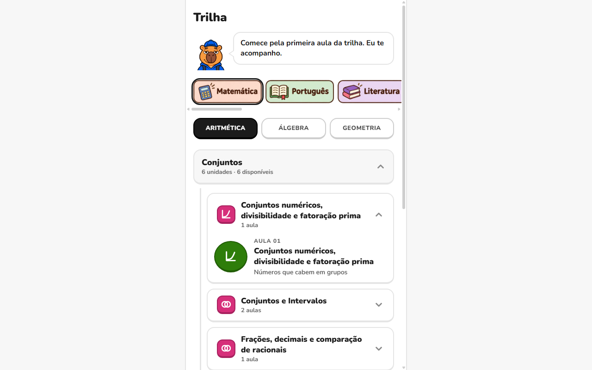
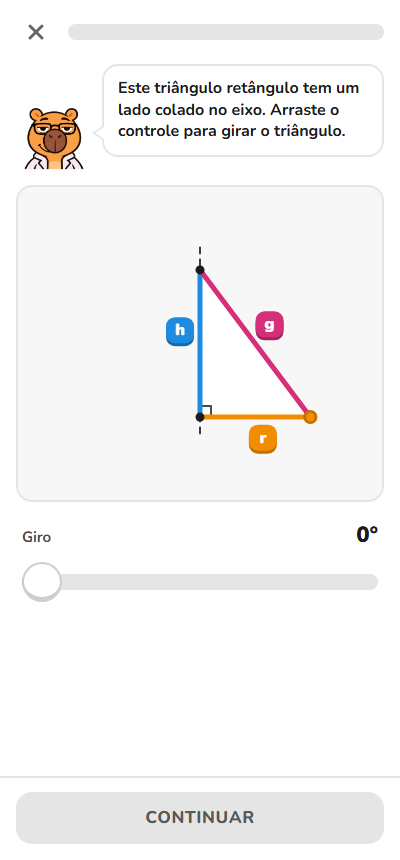
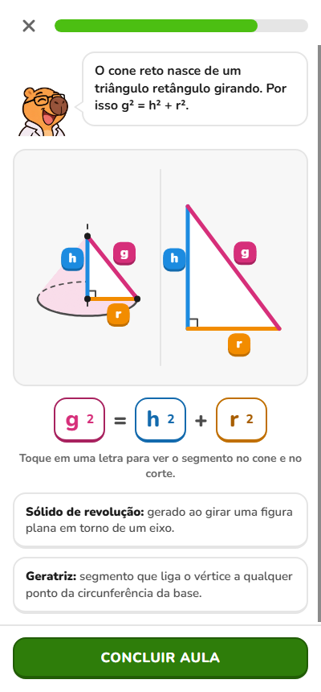
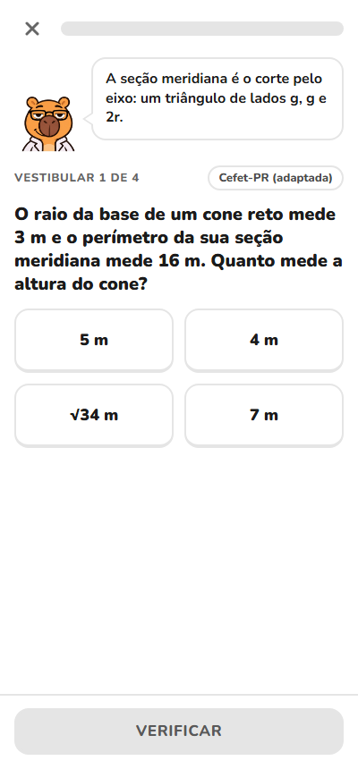

# Matemática Interativa — Ensino Médio

App educativo de **aulas interativas de Matemática do Ensino Médio** (React 19 + TypeScript + Vite, 100% local no navegador, sem backend). Em vez de começar por fórmulas prontas, cada capítulo parte de uma **figura viva** que o aluno manipula para enxergar o porquê da regra antes de praticar.

O app é guiado pelo **Paco** (que conduz a investigação passo a passo) e pela **Tati** (que faz nos momentos certos as perguntas que o aluno teria), seguindo o **método de 7 pilares** documentado em [`docs/METODO.md`](docs/METODO.md): ancoragem mecânica, tradução visual imediata, ponto neutro, panorama de contexto, progressão por contraste, dedução causal da forma e testes de fronteira.

> **Vai apresentar ao júri?** Veja o roteiro cronometrado de 3 a 5 minutos em [`docs/DEMO.md`](docs/DEMO.md).

---

## Capturas reais do app

| Trilha no desktop (`1280 × 800`) | Aula interativa 3D (`400 × 860`) |
| :---: | :---: |
|  |  |

| Fechamento com fórmula tocável (`400 × 860`) | Treino com questão real de vestibular (`400 × 860`) |
| :---: | :---: |
|  |  |

---

## Como abrir

### Jeito mais rápido (Windows, dois cliques)
Execute [`scripts/abrir-app.cmd`](scripts/abrir-app.cmd). Ele verifica o Node.js, instala as dependências na primeira vez, gera o build quando necessário, sobe o servidor local em `http://localhost:4173/` e abre o navegador automaticamente.

### Pelo terminal (desenvolvimento ou build de produção)
Requer Node.js (desenvolvido em Node 26).

```bash
npm install
npm run dev          # servidor de desenvolvimento em http://localhost:5173
```

Para gerar e testar a versão de produção:

```bash
npm run build        # valida conteúdo, checa tipos e gera dist/
npm run preview      # serve o build de produção localmente
```

---

## O que tem dentro

Números medidos diretamente no repositório (comandos de reprodução no fim de [`docs/DEMO.md`](docs/DEMO.md)):

- **104 aulas publicadas** cobrindo todo o currículo do Ensino Médio em **3 pilares** (**Aritmética:** 27 · **Álgebra:** 35 · **Geometria:** 42), **13 setores** e **104 unidades**, somando **560 passos** entre simulações, micro-desafios e fechamentos (com **104 roteiros didáticos** em `docs/planos/`).
- **22 widgets interativos** e **21 figuras estáticas** desenhados em Canvas 2D/3D sem dependências externas de gráficos: plano cartesiano, sólidos 3D, revolução e geratriz do cone, ciclo trigonométrico, triângulos, polígonos, círculos, lugar geométrico, vetores, reta numérica, barras e boxplot, grade de resultados, máquinas de função, transformações no plano, retângulo de áreas, escala decimal, divisão polinomial, grupos inteiros e sistema escalonado.
- **1.248 questões autorais** (12 por aula: 4 fáceis, 3 médias e 5 desafios), cada uma com feedback específico para o erro de cada alternativa.
- **188 questões reais de vestibular** em **98 das 104 aulas**, vindas de **17 bancas** (ENEM, UFRGS, Unicamp, UFPR, ITA, Fuvest, UERJ, UFU, UFSC, UEG, UFT, UPE, UFRR, EsSA, Cefet-MG, Cefet-PR e ETAM).
- **Progresso local** salvo automaticamente no navegador (`localStorage`), lembrando aulas concluídas, último pilar e seções abertas na trilha.

---

## Como a qualidade é garantida

1. **Testes automatizados (`npm test` / `npx vitest run`):** **135 arquivos de teste** e **2.174 testes passando**, cobrindo contrato Zod das aulas, regras de texto, comportamento dos widgets, acessibilidade básica e conferência matemática por conta de cada gabarito.
2. **Validação de conteúdo, roteiros e tipos:**
   ```bash
   npm run lint:content   # schema, regras de texto, sliders e imagens
   npm run lint:planos    # integridade dos 104 roteiros em docs/planos/
   npm run typecheck      # checagem estrita TypeScript (tsc --noEmit)
   ```
3. **Varredura visual automática em navegador headless:** `node scripts/varre-aulas.mjs <porta>` abre todas as **104 aulas** (**560 passos** + **104 treinos**) em Chrome headless a `400 × 860`, conferindo renderização, pixels de cada canvas 2D, rolagem lateral e erros de console (**0 problemas**).
4. **Auditoria de questões de vestibular:** nenhuma fonte é inventada. Questões inseridas são verificadas visualmente no PDF e gabarito oficiais da banca, com conta refeita e URL oficial conferida. Aulas sem questão adequada ao recorte ficam com `vestibular` vazio e o registro de onde foi procurado em `docs/fontes-candidatas/`.

---

## Mapa do repositório

| Caminho | O que contém |
|---|---|
| `content/taxonomy.json` | Estrutura da trilha: pilares, setores, unidades e aulas |
| `content/<pilar>/<setor>/<slug>/aula-01.json` | Conteúdo de cada aula (passos, glossário e treino) |
| `src/App.tsx`, `src/Home.tsx` | Roteamento por hash e tela da trilha |
| `src/engine/` | Motor de aula (`LessonPlayer`), schema Zod, progresso e regras |
| `src/steps/` | Renderização de `interactive_canvas`, `micro_challenge` e `concept_lock` |
| `src/treino/` | Treino pós-aula em 3 etapas (básico, desafios, vestibular) |
| `src/widgets/` | Os 22 widgets interativos e 21 figuras estáticas |
| `src/characters/` | Sprites e diálogos progressivos do Paco e da Tati |
| `src/conteudo/*.test.ts` | Testes por capítulo (passos completáveis e gabaritos por conta) |
| `scripts/` | Atalho `abrir-app.cmd`, lints de conteúdo/planos e `varre-aulas.mjs` |
| `docs/METODO.md` | Os 7 pilares didáticos do projeto |
| `docs/DEMO.md` | Roteiro de demonstração de 3 a 5 minutos para o júri |
| `docs/planos/` | Roteiros didáticos dos capítulos |
| `docs/revisao/` e `docs/visual/` | Registros de auditorias de vestibular, código e produto |
